# Hi, I'm Boss.

I study Digital Science and Technology at Mahidol University. I'm drawn to computer vision because I like finding out what a model can learn from an image and where it gets things wrong.

I want to work as an AI engineer, testing models on real data and building software people can use.

  

## GitHub dashboard

<a href="https://yoshioka1311.github.io/Yoshioka1311/">
  <picture>
    <source media="(max-width: 600px)" srcset="./assets/activity-compact.svg" />
    
  </picture>
   
  Explore the dashboard
</a>
