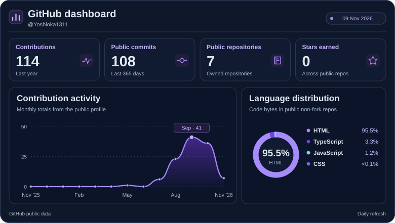

  <picture>
    <source media="(prefers-reduced-motion: reduce)" srcset="./assets/intro-still.svg" />
    
  </picture>

I build software for visual inspection, sign language learning, and everyday workflows.

  <a href="https://github.com/Yoshioka1311#contribution-graph">
    <picture>
      <source media="(max-width: 640px)" srcset="./assets/dashboard-compact.svg" />
      
    </picture>
  </a>

Updated daily. Commits cover indexed public default branches in the last 365 days. Language shares are code bytes from public non-fork repositories, excluding this profile.

## Featured projects

### [CheckOn](https://yoshioka1311.github.io/CheckOn/)

PCB visual inspection using PatchCore anomaly detection. The web gallery presents ten recorded inspections with anomaly heatmaps and dataset annotations.

*Python · PatchCore · JavaScript*

### [HandPrint](https://yoshioka1311.github.io/HandPrint/)

An American Sign Language learning app with an illustrated dictionary, lessons and quizzes on the web, plus gesture recognition in the desktop edition.

*Python · Computer vision · JavaScript*

### [Yoshioka](https://github.com/Yoshioka1311/Yoshioka)

A mobile calendar and Discord bot monitoring app with native reminders and a backend for activity logs and alerts.

*TypeScript · Expo · React Native · Cloudflare Workers · D1*
